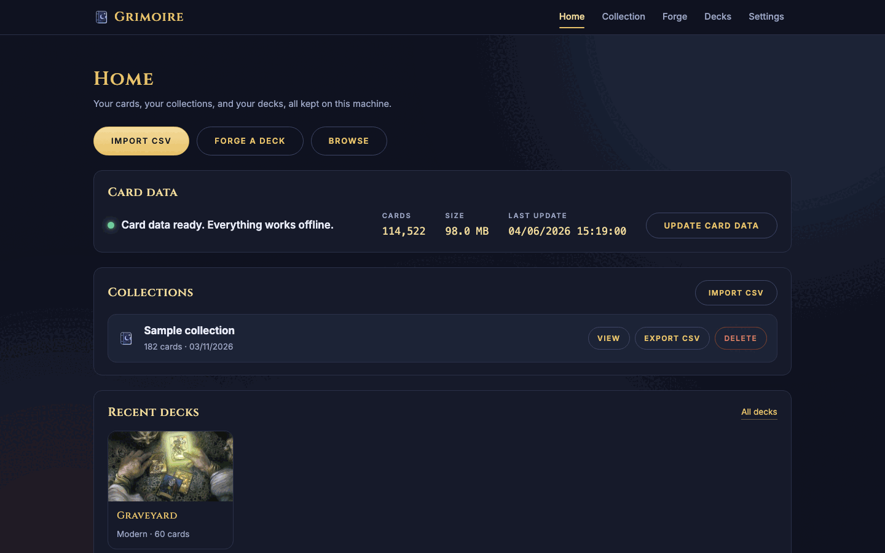
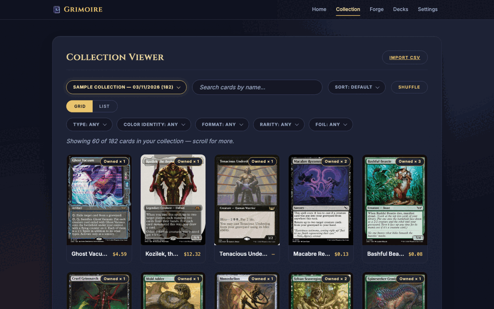
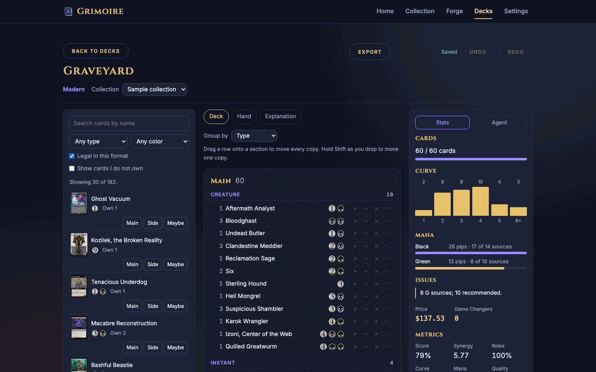

# Grimoire

Forge and edit Magic: The Gathering decks from the cards you own. Grimoire runs on your own machine and enriches your ManaBox exports with Scryfall data.







The screenshots use a synthetic sample collection.

## Features

- **Enrich your CSV.** Import a [ManaBox](https://manabox.app) export. Grimoire adds the mana cost, oracle text, and type line from [Scryfall](https://scryfall.com) bulk data. It shows a summary of the rows it could not match. It exports the enhanced CSV.
- **Collection viewer.** Browse your cards, or all cards in the Scryfall archive. It has infinite scroll, name search, sorting, a shuffle button, and card details. Filters cover card type, color identity, rarity, foil, and format legality.
- **Deck Forge.** An agent builds a deck from only the cards you own. It supports Commander, Brawl, Standard Brawl, Standard, Pioneer, Modern, Legacy, Vintage, Pauper, and Casual.
- **Deck editor.** Edit saved decks with undo and redo, autosave, a stats panel, a sample hand, and legality checks. Import a decklist, or export plain text, Arena text, or CSV.
- **Optional local AI.** If [Ollama](https://ollama.com) runs on your machine, a local model ranks the plans and writes the explanation. There are no cloud calls and no API keys. Choose the model "Engine only" to work without Ollama.
- **Offline.** After the first card data download, nothing needs the internet.
- **Accessible motion.** The interface respects the reduced-motion setting.

## Quick start

You need Python 3.9 or newer.

```bash
pip install -r requirements.txt
python main.py
```

The server opens your browser at **http://localhost:8133**.

1. **Download card data.** On *Home*, press *Download card data*. The download is about 100 MB and happens once.
2. **Import your collection.** Open *Collection*, press *Import CSV*, and drop in your ManaBox export. The `examples/` folder has a synthetic sample file.
3. **Browse.** Use the *Collection* viewer to explore your cards.
4. **Forge a deck.** Open *Forge*, pick a format (and optionally a commander), and start the forge.

For the optional local model, install Ollama and pull a model:

```bash
brew install ollama          # or download from ollama.com
ollama pull qwen3.5:9b       # recommended; about 6.6 GB
```

## How it works

The forge is a pipeline. The engine does the work. A model, when you turn one on, only helps at a few points.

1. The engine reads the full rules text of your cards and tags their roles.
2. The engine builds a synergy graph and finds candidate plans.
3. The agent asks you a question when two plans are close.
4. The engine builds a legal deck and a mana base.
5. The engine reviews the deck and writes the explanation.

**The engine has the last word on legality.** It checks every card name from the model against the cards you own.

**Grimoire is local only.** The server binds to 127.0.0.1, so other machines cannot reach it. Your collections and decks stay in the cache directory on your machine.

## Screens

The top bar has five screens. Each screen has its own address, such as `#home` or `#collection`.

- **Home** shows the card data status, your collections, and your recent decks. You can download the card data here. Each collection row has an *Export CSV* button. It downloads the enhanced CSV. A collection stored by an older version may need a re-import. In that case the app shows a message.
- **Collection** is the viewer for your cards or for all cards in the archive. A card flips to show its other face. The *Import CSV* button opens the importer. The importer shows live progress and a summary of the rows it could not match.
- **Forge** builds a deck from the cards you own (see below).
- **Decks** lists your saved decks and opens the editor (see below).
- **Settings** shows the Ollama status, picks the model (Automatic, Engine only, or one installed model), sets how often the forge asks you a question, and clears the card data.

### The Deck Forge

The forge runs five stages. The screen shows each stage as it runs.

1. **Study cards** — the engine reads the full rules text of your cards.
2. **Find backbones** — the engine builds a synergy graph and finds candidate plans.
3. **Ask you** — when two plans are close, the agent asks you a question. If you do not answer, it takes its recommended option when the countdown ends.
4. **Build** — the engine builds a legal deck and a mana base. When a model is on, the model can swap borderline cards. The engine checks each swap. Without a model, the forge makes no swaps.
5. **Review** — the engine checks the deck: the mana curve, the metrics, and the warnings. Then the forge writes the explanation and a reason for each card. When a model is on, the model writes the explanation and the reasons for the core cards. The engine writes the rest from templates.

The engine has the last word on legality. It checks every card name from the model against the cards you own.

When the forge ends, the editor opens on the new deck.

### Decks and the editor

The *Decks* screen lists your saved decks. Each deck belongs to one format.

- **Create:** press *New deck*, then pick a name, a format, and a collection. The forge also saves each deck it builds.
- **Import:** press *Import decklist*, then paste a decklist. Plain text and Arena formats both work. The editor flags cards you do not own.
- **Edit:** search your cards, add or remove copies, and move cards between sections. Undo and redo work. The stats panel shows the curve, the colors, and the legality checks.
- **Autosave:** the editor saves each change after a short pause. It saves again when you leave. If a save fails, the editor says so, and it refuses an export until a save works.
- **Export:** the export menu gives plain text, Arena-style text, and CSV. You can copy or download the text and Arena kinds. You can only download the CSV kind.
- **Sample hand:** draw a hand of seven cards, and take a mulligan, or draw one more card.
- **Agent panel:** ask the local model to suggest swaps. This needs Ollama (see below). The engine checks each swap before the editor shows it.

### Optional: local AI and models

```bash
brew install ollama          # or download from ollama.com
ollama pull qwen3.5:9b       # recommended; about 6.6 GB
```

Without Ollama, Deck Forge works in engine-only mode. Choose the model "Engine only" to force this mode. The engine builds the deck and writes a template explanation.

Models for a 24 GB Apple-silicon Mac:

| Model | Size | Notes |
|---|---|---|
| `qwen3.5:9b` | 6.6 GB | Recommended. Fits next to your other apps. A forge takes about 1.5–2.5 minutes. |
| `gemma4:12b-it-qat` | 7.2 GB | Light alternative. Not evaluated. |
| `gpt-oss:20b` | 13 GB | Close other apps first. With other apps open, it ran out of memory. |
| `qwen3.8:27b` | 18 GB | Close other apps first. Slow. Not evaluated. |

Evaluation status:

- The hidden-deck evaluation passes in engine-only mode.
- With `qwen3:14b` the evaluation did not yet meet the model pass rule.
- `gpt-oss:20b` did not finish on a 24 GB Mac with other apps open. The Mac ran out of memory, and the first model call timed out.
- With `qwen3.5:9b` (one seed per sample), every model call returned valid JSON, and a forge took 80–140 seconds. Counters passed. Both aristocrats runs scored 0.001–0.022 below the engine baseline, and bogles reached 67% core recall (the rule is 70%).

## Development

```bash
pip install -r requirements.txt
python main.py          # run the server
```

You can also install the package in editable mode. This gives the `grimoire` command.

```bash
pip install -e .
grimoire
```

### Project layout

```
backend/            FastAPI application
  api/              Routes and dependency wiring
  core/             Bulk data manager, CSV processor, collection store,
                    Ollama client, progress tracking, price helper
  forge/            Forge agent: card tagging, synergy graph, deck builder,
                    swaps, metrics, model calls, session and events
  decks/            Saved deck store, deck records and hydration, deck
                    analysis, text import/export, editor agent
  data/playbook.json  Format rules and card-role patterns
  models/           Pydantic schemas
frontend/           Vanilla JS single-page app (ES modules, no build step)
  index.html        The page shell and the editor template
  js/app/           Entry point, hash router, and shell (top bar and nav)
  js/home/          Home screen
  js/collection/    Collection viewer and importer
  js/forge/         Deck Forge screens (setup, stage, feed, timeline)
  js/decks/         Saved decks: list, editor, agent panel, export menu
  js/settings/      Settings screen
  js/shared/        DOM, HTTP, SSE, mana, modal, toast, motion, and
                    settings helpers used by several screens
  css/tokens.css    Colors, fonts, spacing, and motion tokens
  css/base.css      Shared controls, modals, toasts, and mana symbols
  css/shell.css     Atmosphere, top bar, nav, page frame, and footer
  css/tile.css      Shared tile style
  css/home.css, collection.css, forge.css, decks.css, settings.css
                    One style file per screen
scripts/forge_eval.py  Hidden-deck evaluation for the forge
scripts/make_sandbox.py  Builds a safe copy of the cache for manual checks
tests/              Pytest suite (tests/js has the JavaScript tests)
cardvalue.py        Standalone legacy script (per-card Scryfall API lookups)
examples/           Sample ManaBox export for testing
```

### Tests

```bash
npm install             # once, for the jsdom test dependency
npm test                # JavaScript tests (logic, CSS lint, and DOM tests in jsdom)
python -m pytest -q     # Python tests
```

### Test data

The app keeps all data in one cache directory. The default is `.scryfall_cache/`. Set `GRIMOIRE_CACHE_DIR` to use another directory.

Never test against your real collections. Build a sandbox instead. The script links the card index. It copies the metadata file, your collections, and your decks into the new directory.

```bash
python scripts/make_sandbox.py /tmp/grimoire-sandbox
GRIMOIRE_CACHE_DIR=/tmp/grimoire-sandbox python main.py
```

The script refuses a destination inside the real cache. It also refuses a destination that is not empty. Use `--source DIR` to copy from a different cache.

Run the hidden-deck evaluation. It needs the local card index. Run it from the repo root.

```bash
python scripts/forge_eval.py --model none --seeds 3   # engine-only mode
python scripts/forge_eval.py --model qwen3.5:9b       # with a local model
python scripts/forge_eval.py --real                   # check your newest collection
```

The script exits with code 1 when a pass rule fails.

## Requirements

- Python 3.9 or newer.
- Disk space: the card index is about 100 MB. The download needs about 550 MB free while it runs.
- An internet connection for the first download. Ollama is optional.

## Tech stack

- **Backend:** FastAPI, httpx, and Pydantic.
- **Frontend:** vanilla JavaScript and modern CSS. There is no framework and no build step.
- **Data:** the [Scryfall bulk data API](https://scryfall.com/docs/api/bulk-data).
- **AI (optional):** [Ollama](https://ollama.com) with any local chat model.

## License

MIT License.

## Credits

- Card data and images come from [Scryfall](https://scryfall.com).
- Grimoire reads exports from [ManaBox](https://manabox.app).
- Grimoire is not affiliated with or endorsed by Wizards of the Coast.
