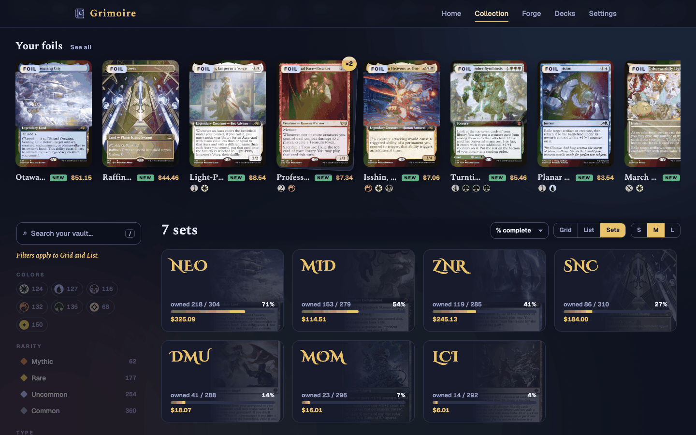
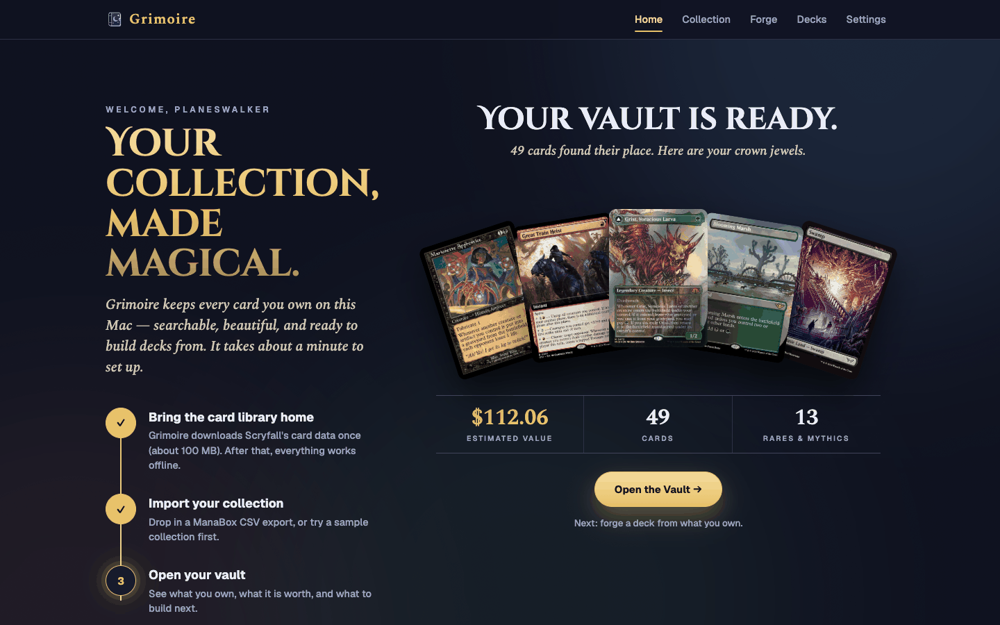

# Grimoire

Forge and edit Magic: The Gathering decks from the cards you own. Grimoire runs on your own machine. It imports your collection from ManaBox, Moxfield, Archidekt and other apps, and enriches it with Scryfall data.







The screenshots use a synthetic sample collection.

## Features

- **Import from many apps.** Import the CSV export of ManaBox, Moxfield, Archidekt, Deckbox, Dragon Shield, TCGplayer, MTGGoldfish, TopDecked, or Magic Online, or paste a plain card list. Grimoire finds each card in the [Scryfall](https://scryfall.com) bulk data and adds the mana cost, oracle text, and type line. It shows a summary of the rows it could not match. It exports the enhanced CSV (see *Importing*).
- **The Vault.** Browse your collection with an insights ledger, today's spotlight, color orbs, a sidebar of live counts, keyword search, tactile card tiles, a card drawer, and a Sets completion view. You can also browse all cards in the Scryfall archive.
- **First-run welcome.** A new owner gets a guided start. It downloads the card data, imports a ManaBox CSV or a sample collection, and shows the most valuable cards.
- **Deck Forge.** An agent builds a deck from only the cards you own. It supports Commander, Brawl, Standard Brawl, Standard, Pioneer, Modern, Legacy, Vintage, Pauper, and Casual.
- **Deck editor.** Edit saved decks with undo and redo, autosave, a stats panel, a sample hand, and legality checks. Import a decklist, or export plain text, Arena text, or CSV.
- **Optional local AI.** If [Ollama](https://ollama.com) runs on your machine, a local model ranks the plans and writes the explanation. There are no cloud calls and no API keys. Choose the model "Engine only" to work without Ollama.
- **Offline.** After the first card data download, nothing needs the internet. The page fonts (Cinzel Decorative, Spectral, and Geist) come from Google Fonts. Without a connection the app uses Georgia and the system fonts.
- **Accessible motion.** The interface respects the reduced-motion setting.

## Quick start

You need Python 3.9 or newer.

```bash
pip install -r requirements.txt
python main.py
```

The server opens your browser at **http://localhost:8133**.

1. **Download card data.** On a first run, the welcome screen does this for you (see *First run*). Otherwise, on *Home*, press *Download card data*. The download is about 100 MB and happens once.
2. **Import your collection.** Drop in the collection export of your app on the welcome screen, or press *Import cards* on the *Collection* screen. You can also paste a card list. The `examples/` folder has a synthetic sample file.
3. **Browse.** Use the *Collection* screen (the Vault) to explore your cards.
4. **Forge a deck.** Open *Forge*, pick a format (and optionally a commander), and start the forge.

For the optional local model, install Ollama and pull a model:

```bash
brew install ollama          # or download from ollama.com
ollama pull qwen3.5:9b       # recommended; about 6.6 GB
```

## First run

When Grimoire has no collection, *Home* and *Collection* open the welcome screen. It has three steps.

1. **Card data.** The screen downloads the Scryfall card data. A sigil shows the progress. If the data is already on disk, this step is done at once.
2. **Import.** Drop a collection export or a card list (`.txt`) on the binder page, or press *Choose a file*. You can also press *Try a sample collection*. The sample imports the small file in `examples/` (19 rows of synthetic data), so you can try the app with no export. The ten slots on the binder light up as the rows go by. At the end, real cards of the new collection flip into the slots.
3. **Reveal.** The most valuable cards fan out, and the ledger counts up: the estimated value, the cards, and the rares and mythics. The *Open the Vault* button takes you to the new collection.

*Skip — just browse all cards* leaves the welcome screen and opens the archive. The browser remembers the choice, so *Home* and *Collection* do not send you back. The welcome screen returns after you import a collection and the collection list later becomes empty.

## How it works

The forge is a pipeline. The engine does the work. A model, when you turn one on, only helps at a few points.

1. The engine reads the full rules text of your cards and tags their roles.
2. The engine builds a synergy graph and finds candidate plans.
3. The agent asks you a question when two plans are close.
4. The engine builds a legal deck and a mana base.
5. The engine reviews the deck and writes the explanation.

**The engine has the last word on legality.** It checks every card name from the model against the cards you own.

**Grimoire is local only.** The server binds to 127.0.0.1, so other machines cannot reach it. Your collections and decks stay in the cache directory on your machine.

## Screens

The top bar has five screens. Each screen has its own address, such as `#home` or `#collection`.

- **Home** shows the card data status, your collections, and your recent decks. You can download the card data here. Each collection row has an *Export CSV* button. It downloads the enhanced CSV. A collection stored by an older version may need a re-import. In that case the app shows a message.
- **Collection** is the Vault, the viewer for your cards or for all cards in the archive (see below). The *Import cards* button opens the importer. The importer shows live progress and a summary of the rows it could not match (see *Importing*).
- **Forge** builds a deck from the cards you own (see below).
- **Decks** lists your saved decks and opens the editor (see below).
- **Settings** shows the Ollama status, picks the model (Automatic, Engine only, or one installed model), sets how often the forge asks you a question, clears the card data, and shows the card images on this Mac. The app downloads the images of your cards in the background when it starts. A switch turns this off, and a button starts a download at any time. *Clear card data* keeps the images. *Remove images* deletes them.

### Importing

The importer takes a file or a pasted list. It finds out which app wrote the file from the header row.

| Source | What to import |
|---|---|
| ManaBox | The CSV export of the collection. The rows stay as they are. |
| Moxfield, Archidekt, Deckbox | The CSV export of the collection. |
| Dragon Shield, TCGplayer, TopDecked, MTGGoldfish, Magic Online | The CSV export of the collection. |
| Another app | A CSV, TSV, or semicolon file with a card name column. |
| A card list | A `.txt` file, or text in the *Paste a card list* box. One card on each line, such as `4 Lightning Bolt`, `1x Sol Ring`, or `1 Sol Ring (CMR) 472 *F*`. Section lines such as *Deck* and *Sideboard* are skipped. |

For each row, Grimoire finds the card in this order:

1. The Scryfall ID, when the row has one.
2. The set and the collector number.
3. The name and the set.
4. The name alone. Then Grimoire takes the cheapest printing that has a price, so a plain list does not overstate the value of the collection.

A name matches in any case and without accents. A split or double-faced card matches by its full name or by one face, such as `Fire/Ice` or `Delver of Secrets`. The summary names the source app and lists each row it could not match.

An import from another app keeps every column of the source file. Grimoire adds the ManaBox columns (such as *Set code* and *Scryfall ID*) to the enhanced CSV. Card data from an older version of Grimoire can lack collector numbers. Then Grimoire matches by name and set only. Press *Update card data* on *Home* to get the exact printings.

**One collection per binder.** ManaBox names the binder of each card, Dragon Shield the folder, and Sorted the list. Grimoire keeps that name on each card. Turn on *One collection per binder* before you import, and each binder of the file becomes its own collection, named after the binder. The option is off by default, so a file becomes one collection. Grimoire has no limit on the number of collections.

### The Vault

The Vault is the *Collection* screen. A switcher at the top picks a collection or the archive.

- **Insights ledger.** Four counters count up: the estimated value, the rares and mythics, the foils, and the number of sets. A line above them gives the card count and the import date. The value note names the date of the Scryfall prices. Each card counts at its price in US dollars: the etched price for an etched foil, the foil price for a foil, and the regular price for other cards. A card with only a EUR or MTGO ticket price has no price. The value is the price times the quantity.
- **Today's spotlight.** A fan of cards shows one rare or mythic of your collection in the middle. The spotlight changes each day. The cards beside it are your most valuable cards. When you have no rare or mythic, the fan shows your most valuable card in the middle.
- **Color orbs.** One orb for each color, for colorless, and for multicolor shows the share of your cards. Press an orb to filter by that color.
- **Index sidebar.** The sidebar lists Colors, Rarity, Type, Mana value, Price, Finish, Legal in, and Set. Each value shows a live count for the current result. The counts change as you search and filter. On a narrow screen the sidebar opens as a sheet.
- **Shelves.** *New since your last import* and *Your foils* show a row of cards each, when there are any. *See all* applies the matching filter. Shelves hide while a search or filter is active.
- **Search.** The search box matches the card name. Keywords combine with AND. They work in any order, in any case.

  | Keyword | Meaning | Example |
  |---|---|---|
  | `t:` | The type line contains the text | `t:creature` |
  | `o:` | The oracle text contains the text (quotes allowed) | `o:"draw a card"` |
  | `c:` | The color identity includes all letters; `c:c` is colorless | `c:ug` |
  | `mv:` | Mana value, exact or a range | `mv:2-4`, `mv:5-` |
  | `r:` | Rarity | `r:mythic` |
  | `s:` | Set code | `s:neo` |
  | `f:` | Legal in a format | `f:modern` |
  | `$` | Price comparison | `$>5`, `$<1` |
  | `foil` or `is:foil` | Foils only | `foil` |
  | `dupes` or `is:dupes` | Quantity above 1 | `dupes` |
  | `new` or `is:new` | Cards added since the previous import of this collection | `new` |

  An unknown keyword stays plain text and matches the name. A bare `foil`, `dupes` or `new` that finds nothing counts as name text, so `new perspectives` finds New Perspectives. A price comparison never matches a card with no price. The archive search takes the same keywords, but not `foil`, `dupes`, or `new`.
- **Tactile tiles.** Each tile tilts toward the pointer, and a foil card has a sheen. The tile shows the quantity, the mana cost, and the price. Tilt is off with a touch screen and with the reduced-motion setting. The view control switches between a grid and a list. The size control sets the card width.
- **Card drawer.** Press a tile to open a drawer at the right, so the results stay in view. The drawer shows a large image, the facts, the prices, the legality of each format, and the saved decks that use the card. A card with two faces has a flip button.
- **Keys.** `/` focuses the search, and `Esc` clears it. The arrow keys move between tiles, and `Enter` opens the drawer. In the drawer, the left and right arrows show the previous and next card, `F` flips the card, and `Esc` closes the drawer.
- **Sets.** The *Sets* view lists each set with the cards you own, a completion bar, and the value you own in it. Each card name counts once in a set. Press a set to open its checklist. The checklist shows missing cards dimmed. *Missing only* hides the cards you own.
- **Remembered view.** The Vault remembers the search, the filters, the sort, the view, and the card size for each collection in your browser. It restores them when you come back.

### The Deck Forge

The forge runs five stages. The screen shows each stage as it runs.

1. **Study cards** — the engine reads the full rules text of your cards.
2. **Find backbones** — the engine builds a synergy graph and finds candidate plans.
3. **Ask you** — when two plans are close, the agent asks you a question. If you do not answer, it takes its recommended option when the countdown ends.
4. **Build** — the engine builds a legal deck and a mana base. When a model is on, the model can swap borderline cards. The engine checks each swap. Without a model, the forge makes no swaps.
5. **Review** — the engine checks the deck: the mana curve, the metrics, and the warnings. Then the forge writes the explanation and a reason for each card. When a model is on, the model writes the explanation and the reasons for the core cards. The engine writes the rest from templates.

The engine has the last word on legality. It checks every card name from the model against the cards you own.

When the forge ends, the editor opens on the new deck.

### Decks and the editor

The *Decks* screen lists your saved decks. Each deck belongs to one format.

- **Create:** press *New deck*, then pick a name, a format, and a collection. The forge also saves each deck it builds.
- **Import:** press *Import decklist*, then paste a decklist. Plain text, Arena, MTGO and Archidekt lists all work: section lines such as *Sideboard (15)*, lines such as *SB: 2 Duress* or *Commander: Krenko, Mob Boss*, Arena's *About* block, and Archidekt category tags. A companion goes to the sideboard once. The editor flags cards you do not own.
- **Edit:** search your cards, add or remove copies, and move cards between sections. Undo and redo work. The stats panel shows the curve, the colors, and the legality checks.
- **Autosave:** the editor saves each change after a short pause. It saves again when you leave. If a save fails, the editor says so, and it refuses an export until a save works.
- **Export:** the export menu gives plain text, Arena-style text, and CSV. You can copy or download the text and Arena kinds. You can only download the CSV kind.
- **Sample hand:** draw a hand of seven cards, and take a mulligan, or draw one more card.
- **Pull list:** the *Pull list* view shows where each card of the deck is, grouped by collection and binder, so you can take the cards out one binder at a time. It takes the same printing first, then the deck's own collection, then the largest stack. Basic lands and cards that no collection holds have their own groups. Tick each card as you pull it, or copy the list as text.
- **Agent panel:** ask the local model to suggest swaps. This needs Ollama (see below). The engine checks each swap before the editor shows it.

### Optional: local AI and models

```bash
brew install ollama          # or download from ollama.com
ollama pull qwen3.5:9b       # recommended; about 6.6 GB
```

Without Ollama, Deck Forge works in engine-only mode. Choose the model "Engine only" to force this mode. The engine builds the deck and writes a template explanation.

Models for a 24 GB Apple-silicon Mac:

| Model | Size | Notes |
|---|---|---|
| `qwen3.5:9b` | 6.6 GB | Recommended. Fits next to your other apps. A forge takes about 1.5–2.5 minutes. |
| `gemma4:12b-it-qat` | 7.2 GB | Light alternative. Not evaluated. |
| `gpt-oss:20b` | 13 GB | Close other apps first. With other apps open, it ran out of memory. |
| `qwen3.8:27b` | 18 GB | Close other apps first. Slow. Not evaluated. |

Evaluation status:

- The hidden-deck evaluation passes in engine-only mode.
- With `qwen3:14b` the evaluation did not yet meet the model pass rule.
- `gpt-oss:20b` did not finish on a 24 GB Mac with other apps open. The Mac ran out of memory, and the first model call timed out.
- With `qwen3.5:9b` (one seed per sample), every model call returned valid JSON, and a forge took 80–140 seconds. Counters passed. Both aristocrats runs scored 0.001–0.022 below the engine baseline, and bogles reached 67% core recall (the rule is 70%).

## Development

```bash
pip install -r requirements.txt
python main.py          # run the server
```

You can also install the package in editable mode. This gives the `grimoire` command.

```bash
pip install -e .
grimoire
```

### Project layout

```
backend/            FastAPI application
  api/              Routes and dependency wiring
  core/             Bulk data manager, CSV processor, collection store,
                    Ollama client, progress tracking, price helper
  forge/            Forge agent: card tagging, synergy graph, deck builder,
                    swaps, metrics, model calls, session and events
  decks/            Saved deck store, deck records and hydration, deck
                    analysis, text import/export, editor agent
  data/playbook.json  Format rules and card-role patterns
  models/           Pydantic schemas
frontend/           Vanilla JS single-page app (ES modules, no build step)
  index.html        The page shell and the editor template
  js/app/           Entry point, hash router, and shell (top bar and nav)
  js/home/          Home screen
  js/collection/    The Vault (hero, sidebar, list, drawer, sets) and the importer
  js/welcome/       First-run welcome screen and its gate
  js/forge/         Deck Forge screens (setup, stage, feed, timeline)
  js/decks/         Saved decks: list, editor, agent panel, export menu
  js/settings/      Settings screen
  js/shared/        DOM, HTTP, SSE, mana, modal, toast, motion, and
                    settings helpers used by several screens
  css/tokens.css    Colors, fonts, spacing, and motion tokens
  css/base.css      Shared buttons, modals, toasts, and mana symbols
  css/shell.css     Atmosphere, top bar, nav, page frame, and footer
  css/tile.css      Shared tile style
  css/home.css, collection.css, vault.css, welcome.css, forge.css,
  decks.css, settings.css
                    One style file per screen (collection.css is the importer)
scripts/forge_eval.py  Hidden-deck evaluation for the forge
scripts/make_sandbox.py  Builds a safe copy of the cache for manual checks
tests/              Pytest suite (tests/js has the JavaScript tests)
cardvalue.py        Standalone legacy script (per-card Scryfall API lookups)
examples/           Sample ManaBox export for testing
```

### Tests

```bash
npm install             # once, for the jsdom test dependency
npm test                # JavaScript tests (logic, CSS lint, and DOM tests in jsdom)
python -m pytest -q     # Python tests
```

### Test data

The app keeps all data in one cache directory. The default is `.scryfall_cache/`. Set `GRIMOIRE_CACHE_DIR` to use another directory.

Card images live in `images/` inside the cache directory. The app downloads each image once from Scryfall's image server. It stores two sizes: a small thumbnail (about 10 KB) and the normal image. The download fetches every small image first, so each grid shows a picture quickly. Then it fetches the normal images. It starts with the cards of your decks and collections. It serves every later request from disk. Each image URL carries the version of the card data. When Scryfall changes an image and you update the card data, the browser asks the server again. The server then sends the old file at once and downloads the new file in the background. The next request gets the new file.

Never test against your real collections. Build a sandbox instead. The script links the card index. It copies the metadata file, your collections, and your decks into the new directory.

```bash
python scripts/make_sandbox.py /tmp/grimoire-sandbox
GRIMOIRE_CACHE_DIR=/tmp/grimoire-sandbox python main.py
```

The script refuses a destination inside the real cache. It also refuses a destination that is not empty. Use `--source DIR` to copy from a different cache.

Run the hidden-deck evaluation. It needs the local card index. Run it from the repo root.

```bash
python scripts/forge_eval.py --model none --seeds 3   # engine-only mode
python scripts/forge_eval.py --model qwen3.5:9b       # with a local model
python scripts/forge_eval.py --real                   # check your newest collection
```

The script exits with code 1 when a pass rule fails.

## Requirements

- Python 3.9 or newer.
- Disk space: the card index is about 100 MB. The download needs about 550 MB free while it runs.
- An internet connection for the first download. Ollama is optional.

## Tech stack

- **Backend:** FastAPI, httpx, and Pydantic.
- **Frontend:** vanilla JavaScript and modern CSS. There is no framework and no build step.
- **Data:** the [Scryfall bulk data API](https://scryfall.com/docs/api/bulk-data).
- **AI (optional):** [Ollama](https://ollama.com) with any local chat model.

## License

Grimoire is free software under the [MIT License](LICENSE). The card data and images belong to their owners (see *Credits*).

## Credits

- Card data and images come from [Scryfall](https://scryfall.com).
- Grimoire reads exports from [ManaBox](https://manabox.app).
- Grimoire is not affiliated with or endorsed by Wizards of the Coast.
